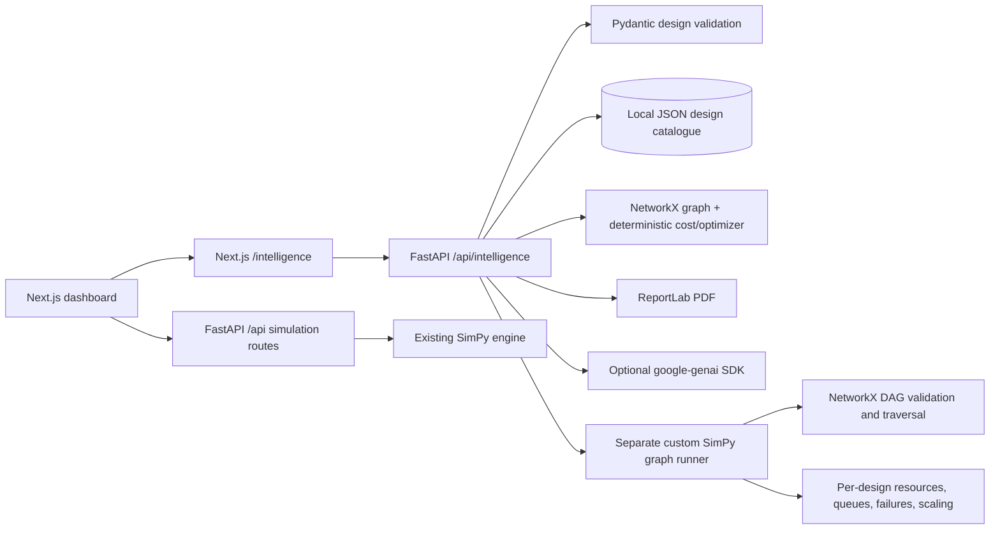

# Architecture and integration

The existing simulation route, models, architecture definitions, scenarios, and engine are unchanged. `backend/main.py` adds a separate router include. `backend/api/intelligence.py` defines independent design/advisor/analysis endpoints; `backend/api/custom_simulation.py` mounts the separate run, comparison, scenario and AI-analysis routes under `/api/intelligence/simulation/`. `backend/models/custom_simulation.py` validates its graph/scenario inputs, and `backend/services/custom_simulation.py` adapts the graph to SimPy containers, request processes and event models. The predefined strategies enter custom comparison through a local graph adapter, not by invoking the legacy simulation engine. `backend/services/intelligence.py` contains the price catalogue, deterministic analysis, optional Gemini adapter and PDF generation. Designs are stored in `backend/data/designs.json` and ignored by Git. No database or cloud service is required.

The separate Next.js routes `frontend/app/intelligence/page.tsx` and `frontend/app/intelligence/simulation/page.tsx` provide the designer and simulation dashboard. The designer exposes component configuration and connections; the runner uses the installed React Flow package for topology playback and Recharts for metric timelines and comparisons. A single navigation link from the existing dashboard opens the center; the current simulation and comparison screens remain mounted as before.

NetworkX analysis returns concrete topology findings such as articulation choke points, single points of failure, disconnected components and cascade dependencies; it does not produce aggregate heuristic scores or measured availability. The Architecture Expert asks Gemini for a baseline architecture with identified risks left unmitigated and a second architecture that addresses them, validates both against Pydantic models, and lets the user load either one into the editor. Risk claims are grounded in the supplied product description and uncertain claims are labeled as assumptions. The custom runner's numerical results come from its independent SimPy instance. The estimate catalogue is configurable in `PRICES` in `backend/services/intelligence.py` and is explicitly illustrative. Gemini is only called by optional advisor, comparison-narrative and simulation-analysis routes; its credentials remain on the backend.
