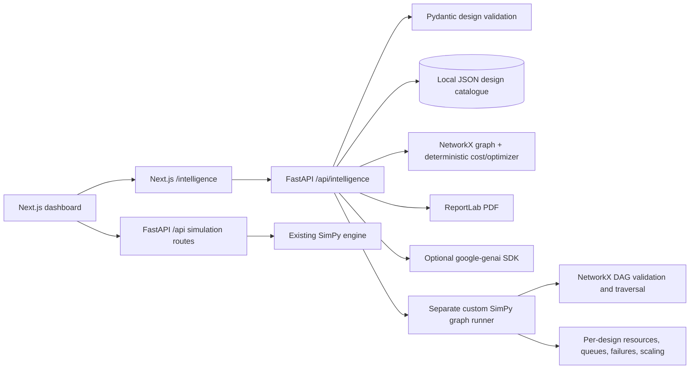

# Architecture and integration

The existing simulation route, models, architecture definitions, scenarios, and engine are unchanged. `backend/main.py` adds a separate router include. `backend/api/intelligence.py` defines independent design/advisor/analysis endpoints; `backend/api/custom_simulation.py` mounts the separate run, comparison, scenario and AI-analysis routes under `/api/intelligence/simulation/`. `backend/models/custom_simulation.py` validates its graph/scenario inputs, and `backend/services/custom_simulation.py` adapts the graph to SimPy containers, request processes and event models. The predefined strategies enter custom comparison through a local graph adapter, not by invoking the legacy simulation engine. `backend/services/intelligence.py` contains the price catalogue, deterministic analysis, optional Gemini adapter and PDF generation. Designs are stored in `backend/data/designs.json` and ignored by Git. No database or cloud service is required.

The separate Next.js routes `frontend/app/intelligence/page.tsx` and `frontend/app/intelligence/simulation/page.tsx` provide the designer and simulation dashboard. The designer exposes component configuration and connections; the runner uses the installed React Flow package for topology playback and Recharts for metric timelines and comparisons. A single navigation link from the existing dashboard opens the center; the current simulation and comparison screens remain mounted as before.

Graph reliability and architecture quality indicators are deterministic graph heuristics. They are not measured uptime or custom/legacy SimPy results. Custom runner numerical results come from its independent SimPy instance and are distinct from graph-analysis heuristics. The estimate catalogue is configurable in `PRICES` in `backend/services/intelligence.py` and is explicitly illustrative. Gemini is only called by optional advisor, comparison-narrative and simulation-analysis routes; its credentials remain on the backend.
